<!-- README.md is generated from README.Rmd. Please edit that file -->

# tidylayouts <a href="https://jbengler.github.io/tidylayouts/"></a>

<!-- badges: start -->

<!-- badges: end -->

The goal of `tidylayouts` is to streamline the creation of multi-plot
layouts for scientific papers. It allows to gradually expand and adjust
layouts using a consistent and intuitive syntax.

`tidylayouts` is built around the pipe and supports plots with absolute
dimensions, such as those created with `tidyplots`, as well as plain
`ggplot2` plots. Plots are aligned by their **panels**, not by their
outer boxes, so axes and tags line up across the whole figure.

## Installation

<!--
&#10;You can install the released version of tidylayouts from [CRAN](https://cran.r-project.org/) with:
``` r
install.packages("tidylayouts")
```
&#10;-->

You can install the development version from
[GitHub](https://github.com/) with:

``` r
# install.packages("pak")
pak::pak("jbengler/tidylayouts")
```

## Usage

Build a figure step by step: `new_row()` adds a row of plots below
everything so far, `new_column()` adds a column to the right.

``` r
library(tidylayouts)

new_row(p1, p2) |>
  new_row(p3, p4) |>
  new_column(auto_height(p5)) |>
  new_column(auto_height(p6)) |>
  new_row(auto_width(p7))
```

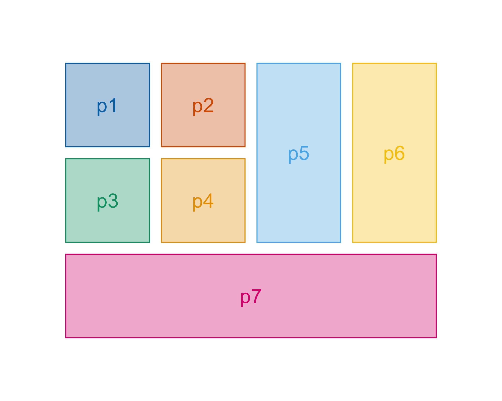

All plots above have a fixed panel size of 30 × 30 mm. `auto_height()`
and `auto_width()` let the layout decide the panel size: the panel fills
the space it gets from its neighbours: `p5` and `p6` span the height of
the block on the left, `p7` spans the width of everything above.

`new_grid()` adds a block of plots that share rows and columns.

## Real plots

``` r
tidyplots_options(
  width = 25,
  height = 25,
  my_style = function(x) x |> remove_legend()
)

p1 <- study |>
  tidyplot(x = group, y = score, color = dose) |>
  add_mean_bar(alpha = 0.3) |>
  add_sem_errorbar() |>
  add_data_points() |>
  add_test_asterisks(hide_info = TRUE)
p2 <- time_course |>
  tidyplot(x = day, y = score, color = treatment, dodge_width = 0) |>
  add_mean_line() |>
  add_sem_ribbon()
p3 <- energy_week |>
  tidyplot(x = date, y = power, color = energy_source) |>
  add_areastack_relative()
p4 <- energy |>
  tidyplot(y = energy, color = energy_source) |>
  add_donut()
p5 <- climate |>
  tidyplot(x = month, y = year, color = max_temperature) |>
  add_heatmap() |>
  adjust_size(height = 55)
p6 <- gene_expression |>
  tidyplot(x = sample, y = external_gene_name, color = expression) |>
  add_heatmap(scale = "row") |>
  sort_y_axis_labels(direction, -padj) |>
  adjust_size(height = 55) |>
  remove_x_axis_title() |>
  remove_y_axis_title()
p7 <- gene_expression |>
  head(100) |>
  tidyplot(x = sample_type, y = expression, color = condition) |>
  add_violin() |>
  add_data_points_beeswarm(white_border = TRUE) |>
  adjust_x_axis_title("") |>
  add_test_asterisks(hide_info = TRUE, bracket.nudge.y = 0.3) |>
  adjust_y_axis_title("Gene expression") |>
  split_plot(by = external_gene_name, nrow = 1)

tidyplots_options()
```

By default, plots keep their size. In a row, panels are aligned at the
bottom so that the x axes line up. The panel tags are still aligned at
the top of the row.

``` r
new_row(p1, p2) |>
  new_row(p3, p4) |>
  new_column(p5) |>
  new_column(p6) |>
  new_row(p7) |>
  layout_tags("A")
```

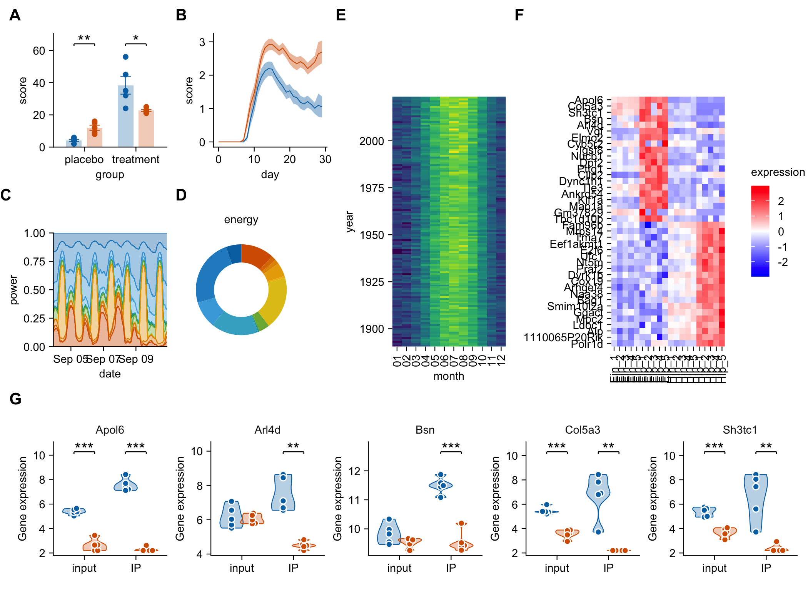

Freeing the heatmaps and the violin plots makes them fill the available
space.

``` r
new_row(p1, p2) |>
  new_row(p3, p4) |>
  new_column(auto_height(p5)) |>
  new_column(auto_height(p6)) |>
  new_row(auto_width(p7)) |>
  layout_tags("A")
```


## Design strings

`new_layout()` describes a whole figure in one call. Each letter in the
design is a plot; plots are assigned in alphabetical order of the
letters, and `#` marks an empty cell.

``` r
new_layout(
  tag_group(p1, p2), p3, p4, p5, p6, p7,
  design = "
    ABEF
    CDEF
    GGGG
  ",
  auto_width = "G",
  auto_height = "EF",
  auto_margins_x = "D",
  tags = "A"
)
```

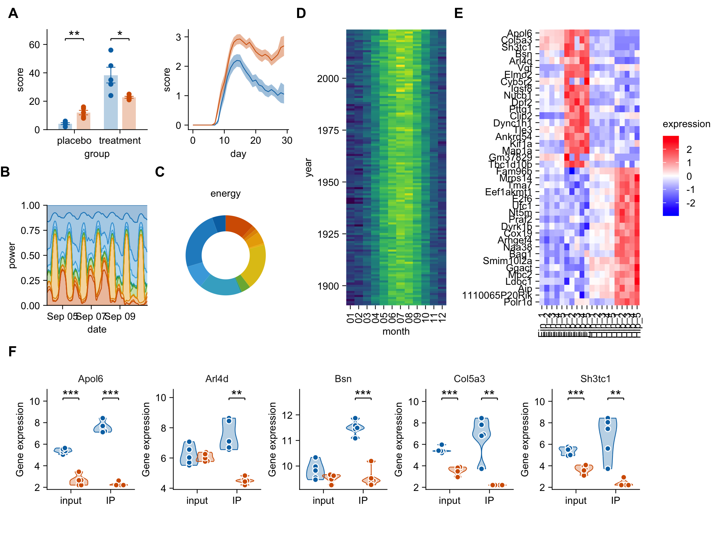

By default, each line of the design becomes a row, so the figure above
has the same structure as
`new_row(p1, p2) |> new_row(p3, p4) |> new_column(p5) |> new_column(p6) |> new_row(p7)`.
With `arrange_by = "column"`, each design column becomes a column
instead, and with `arrange_by = "grid"` plots in the same row and column
of the design share their lines.

The design shows the arrangement, not the size: plots keep their panel
sizes, also when they span several cells. `auto_width`, `auto_height`,
`auto_margins_x` and `auto_margins_y` change that for the listed plots,
like the functions `auto_width()`, `auto_height()` and `auto_margins()`.
Tags are numbered in reading order, as with `layout_tags()`; here
`tag_group()` lets the first two plots share tag A.

## Alignment

Plots with a fixed size often leave some space in their row or column.
`horizontal_align` and `vertical_align` decide where it goes. The
defaults are `"left"` and `"bottom"`, where the axis lines are.

``` r
new_row(p1, p2)
```

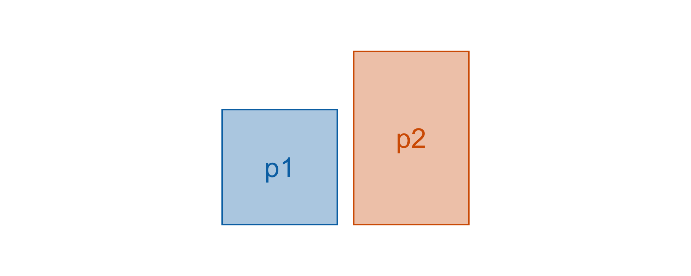

``` r
new_row(p1, p2, vertical_align = "top")
```

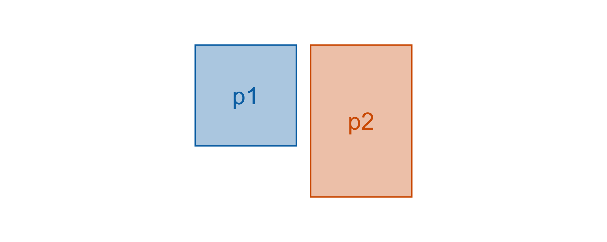

``` r
new_row(p1, p2, vertical_align = "center")
```

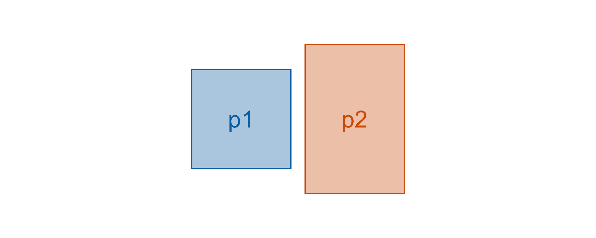

``` r
new_column(p1, p3, horizontal_align = "center")
```

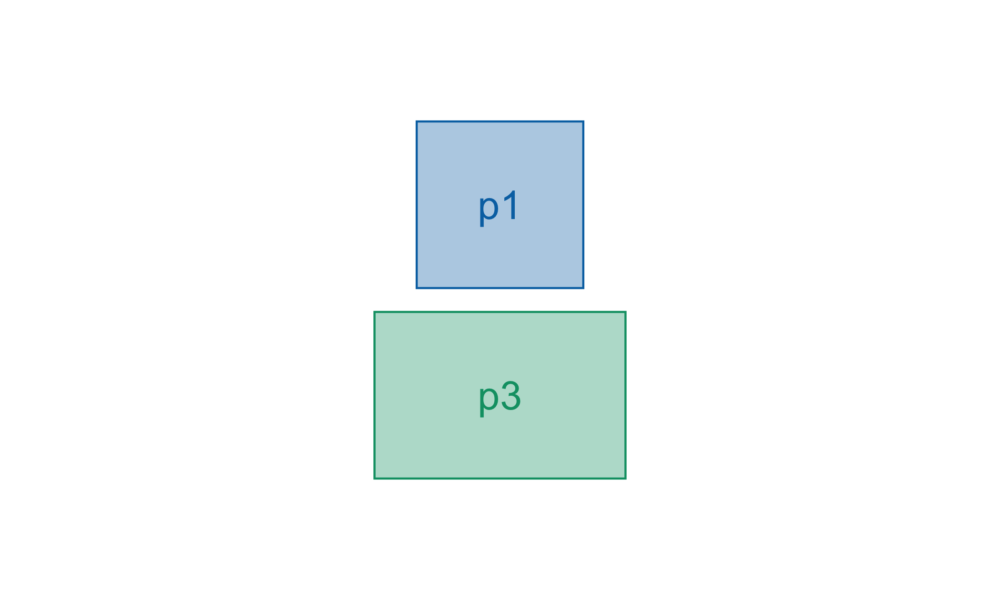

Alignment applies to what is directly inside a row or column. A nested
row fills the width it is given and arranges its own plots, e.g. with
the extra space between them:

``` r
new_row(p3, p3) |>
  new_row(p1, p1, horizontal_align = "justify")
```

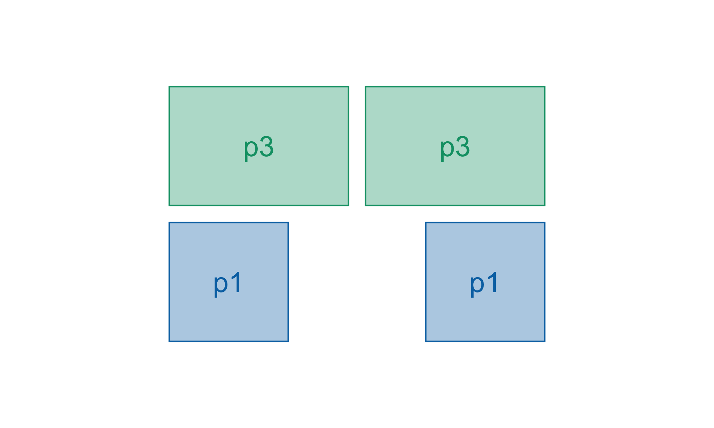

To center a single plot within the spare space next to it, use
`auto_margins()`. The panel keeps its size, the extra space goes to both
sides, and the tag stays at the edge of the space. Use `y = FALSE` to
center only horizontally, so the plot keeps the row’s shared bottom
edge.

``` r
new_row(p3, p3) |>
  new_row(p1, auto_margins(p1, y = FALSE)) |>
  layout_tags("A")
```

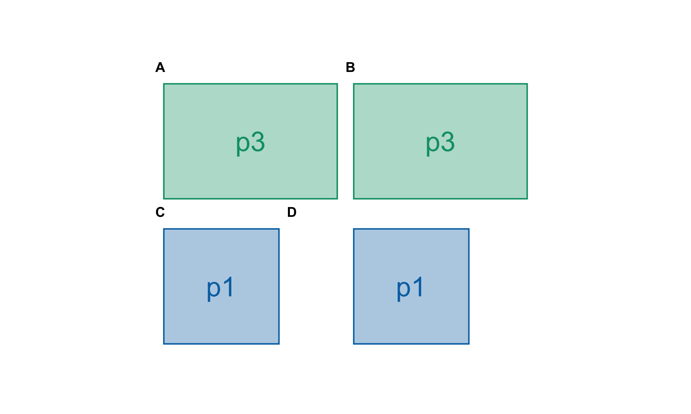

## Rows of plots vs. grids

`new_row()` lays out each row independently. `new_grid()` shares row and
column tracks, so plots in the same grid column line up exactly.

``` r
new_row(narrow, narrow) |> new_row(wide, wide)
```

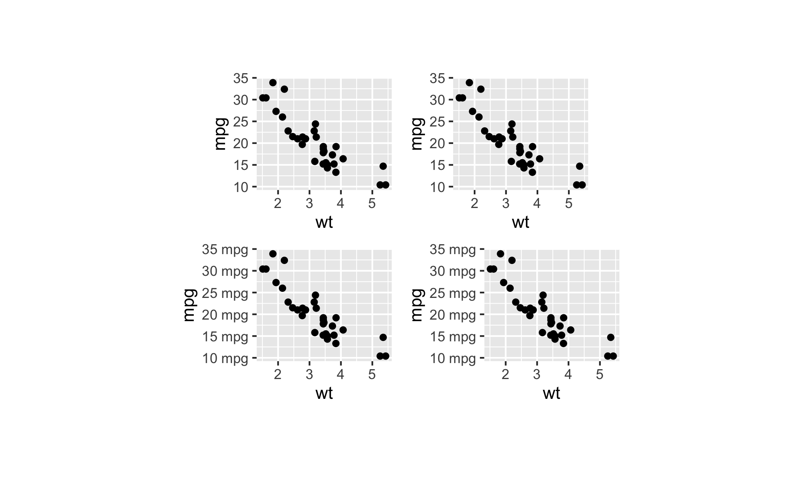

``` r
new_grid(narrow, narrow, wide, wide, ncol = 2)
```

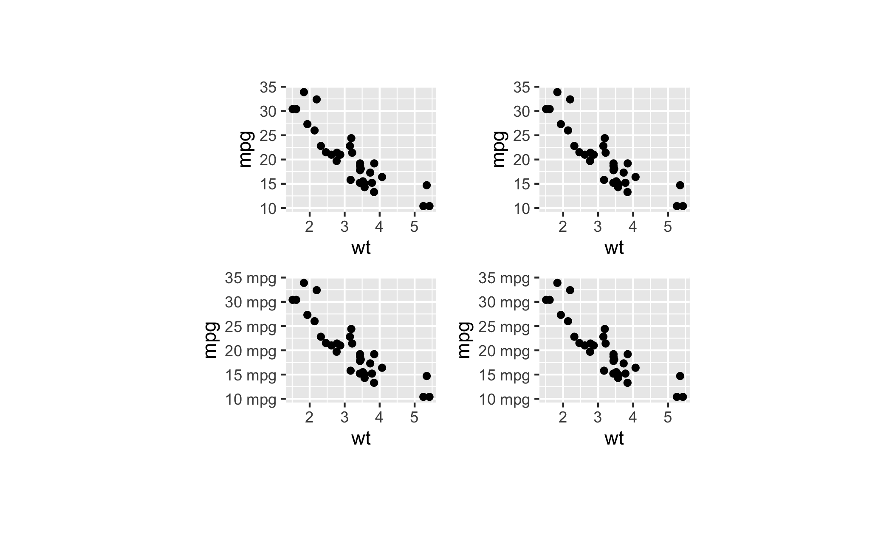

## Wrapping rows

`new_row(..., wrap = <mm>)` breaks a long row into lines, like text in a
word processor: each line takes as many plots as fit, axis labels and
gaps included. This is handy when plots have different widths.

``` r
new_row(panels, wrap = 140, horizontal_align = "justify") |>
  layout_tags("A")
```

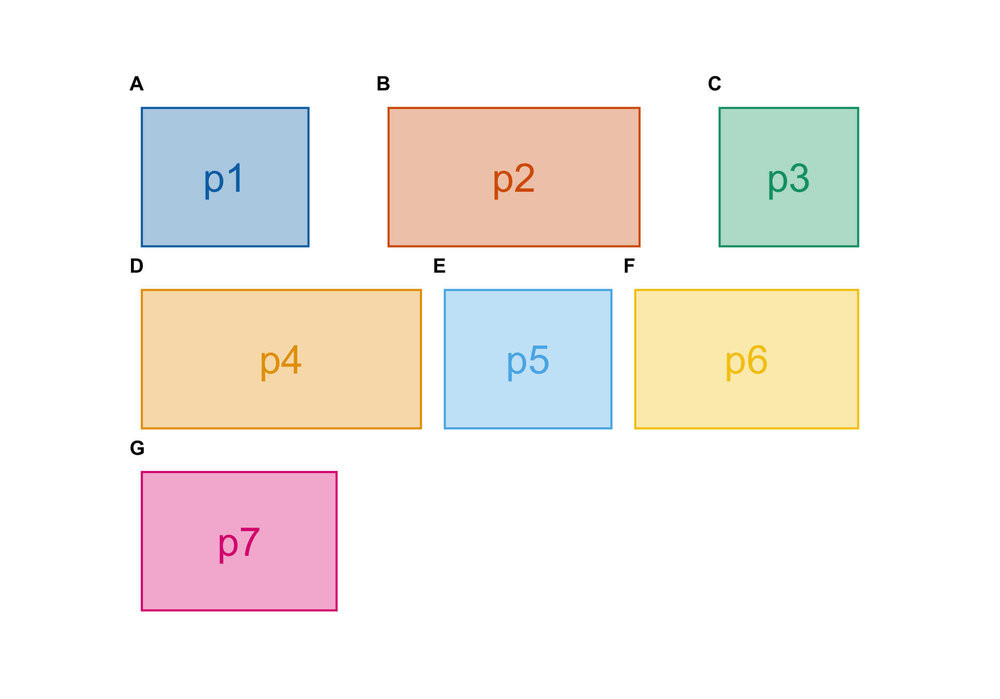

With `horizontal_align = "justify"`, all lines but the last are spread
to the width of the widest line.

`new_column(..., wrap = <mm>)` does the same vertically: a column that
is too tall continues in a new column to the right, like newspaper
columns.

For plots of similar width, such as small multiples,
`new_grid(..., wrap = <mm>)` picks as many grid columns as fit. All rows
share the same columns, so the plots line up in both directions.

``` r
small <- lapply(1:7, function(i) dummy(width = 30, height = 20, name = paste0("p", i), color = cols[i]))

new_grid(small, wrap = 120) |>
  layout_tags("A")
```

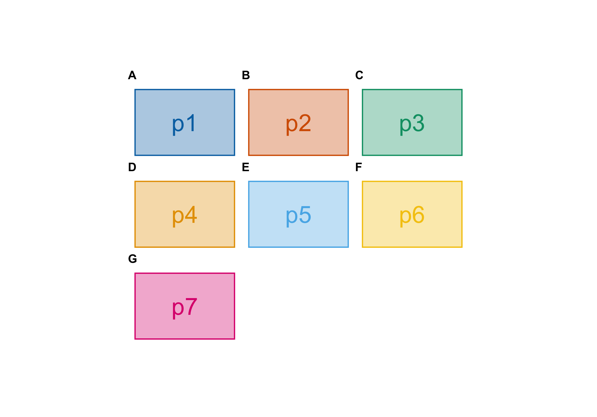

## Layout options

``` r
new_row(narrow, wide) |>
  new_row(auto_width(narrow)) |>
  layout_tags("a") |>
  layout_title("Figure 1") |>
  layout_size(width = 120)
```

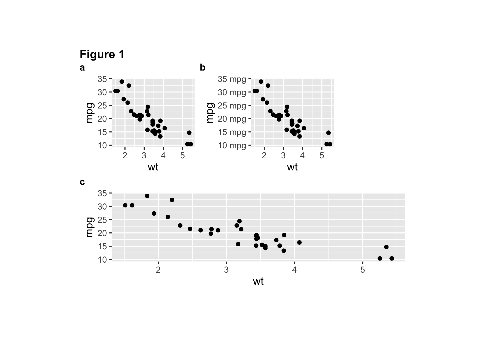

To let several plots share one tag, wrap them in `tag_group()`. Only the
first plot of the group gets a tag, and the sequence continues after the
group.

``` r
tag_group(new_row(narrow, wide)) |>
  new_row(auto_width(narrow)) |>
  layout_tags("A")
```

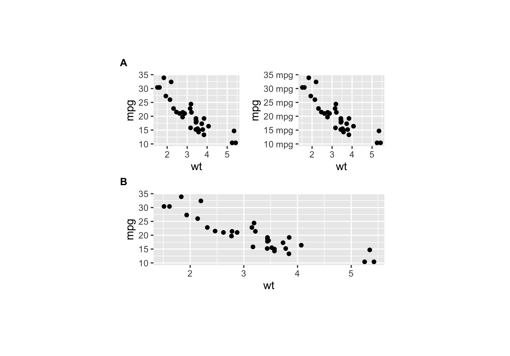

By default, the gaps between plots come from each plot’s own margins.
`layout_spacing()` replaces them with fixed gaps in mm, so spacing stays
even when plots use different themes. `inner` takes one value for both
directions or `c(horizontal, vertical)`; `outer` adds a margin around
the whole figure.

``` r
new_row(narrow, wide) |>
  new_row(auto_width(narrow)) |>
  layout_tags("a") |>
  layout_spacing(inner = c(2, 6), outer = 5)
```

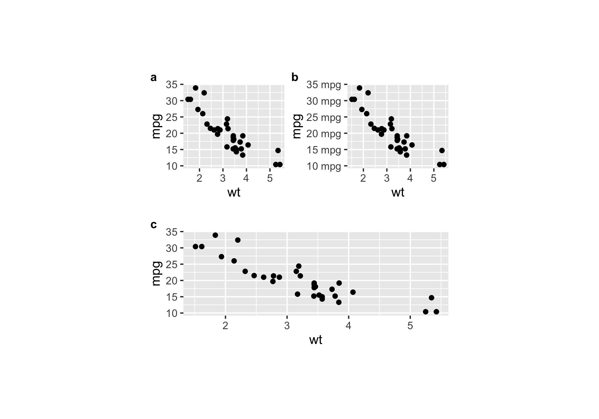

Save a figure at its exact physical size with `save_layout()`. If all
panels have a fixed size, the figure size is computed from the layout.

``` r
save_layout(my_layout, "figure1.pdf")
save_layout(my_layout, "figure1.pdf", width = 183)  # Nature double column
```

## Placeholders

`dummy()` creates placeholder plots for sketching layouts. `spacer()`
creates an empty slot: with a size in mm it is a fixed gap, without a
size it absorbs leftover space.

``` r
new_row(p1, spacer(width = 20), p1)
```


``` r
new_row(p1, spacer(), p1) |> layout_size(width = 150)
```

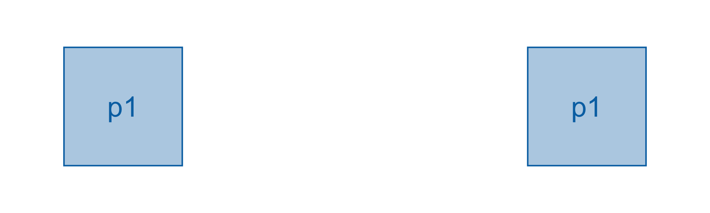
